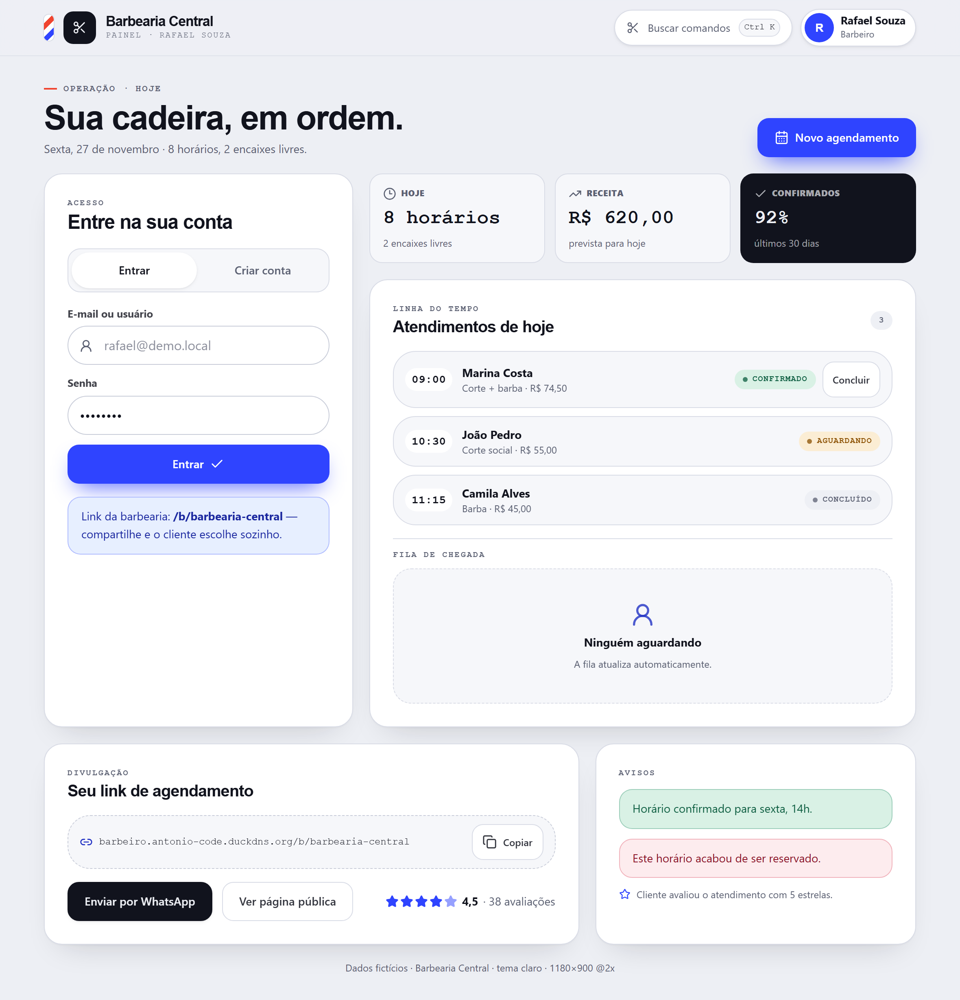
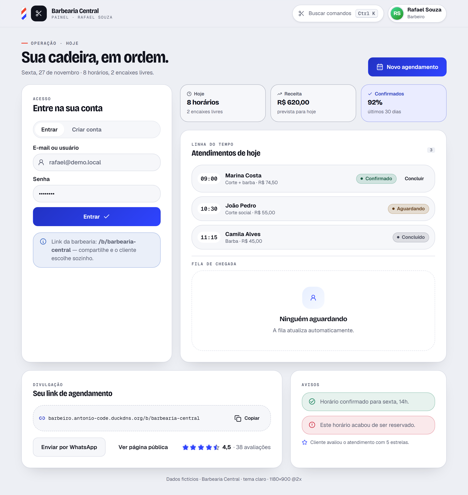

# Migração para `@juninmd/sonido@^2.5.0`

O `web/` passou a consumir as primitivas do design system Sonido no lugar das
cópias locais. A identidade do Meu Barbeiro continua no comando: `--amber`
(cor da barbearia, definida em runtime) é o acento do Sonido, e superfícies,
texto e bordas vêm dos tokens semânticos que já respondem a `data-theme`.





Capturas em Chromium, viewport 1180×900, `fullPage`, device scale 2, tema claro,
dados fictícios (Barbearia Central / Marina Costa). O harness usado nas duas
capturas foi **efêmero**: `web/shot.html` + `web/src/shot.tsx` existiram apenas
durante a geração das imagens e foram removidos antes do commit. O lado "antes"
rodou num checkout temporário de `origin/master` fora do repositório
(`git worktree add --detach .../before-meu-barbeiro origin/master`), na porta
5331; o "depois" rodou na árvore de trabalho, na porta 5321. Nenhum arquivo de
componente antigo, `preview.*` ou pasta `legacy/` foi versionado.

## Componentes trocados

| Primitiva | Antes | Depois (`@juninmd/sonido`) | Arquivos |
| --- | --- | --- | --- |
| `Button` | `cva` local com `primary/dark/ghost/danger` | `Button` com `variant`, `size` (`xs`…`icon`), `appearance`, `loading` e gradiente da marca; adaptador preserva a API antiga e o alvo de 44px | `web/src/components/ui/Button.tsx` (48 usos) |
| `Badge` / `CountBadge` / `StatusBadge` | `cva` local; contador próprio | `Badge` com `tone`, `dot`, `live`, `appearance="count"` | `ui/Badge.tsx`, `StatusBadge.tsx`, `WalkInQueuePanel`, `ClientDashboard`, `BarberDashboard`, `ProductsPanel` |
| `Avatar` | inicial única local | `Avatar` do Sonido (iniciais, matiz estável, anel, tamanho numérico) | `ui/Avatar.tsx`, `Shell.tsx`, `DesignSystemPage` |
| `Tabs` | Radix Tabs (`TabsList`/`TabsTrigger`/`TabsContent`) | `Tabs` WAI-ARIA (`items`, `variant="pill"`, `hasPanels`) | `Login.tsx`, `DesignSystemPage`; `ui/Tabs.tsx` removido |
| `EmptyState` | `div` com filhos arbitrários | `EmptyState` com `icon`, `title`, `description`, `action` | `WalkInQueuePanel`, `BarberDashboard`, `ClientDashboard`; `ui/EmptyState.tsx` removido |
| `Notice` | `p` com `cva` | `Alert` (tom define `role=alert`/`status`) | `ui/Notice.tsx` + 13 telas |
| `Stars` / `StarInput` | estrelas locais + radiogroup manual | `Rating` (leitura e radiogroup com setas) | `ui/Stars.tsx`, `ReviewDialog`, `PublicShop`, `ClientDashboard` |
| `CommandPalette` | `cmdk` + Radix Dialog | `CommandPalette` do Sonido (`<dialog>` nativo, grupos, busca sem acento, setas/Enter) | `CommandPalette.tsx`, `Shell.tsx` |
| `Tooltip` | Radix Tooltip + `TooltipProvider` | `Tooltip` CSS do Sonido (`content` + `aria-describedby`) | `DesignSystemPage`; `ui/Tooltip.tsx` removido |
| `Field`/`Input` parcial | `Field` + `Input` locais | `TextField` (input, `multiline`, dica/erro) | `DesignSystemPage`, `ReviewDialog` |
| `Skeleton` parcial | bloco com altura arbitrária | `Skeleton` de linhas do Sonido | `DesignSystemPage` |
| `StatTile` | artigo local com `featured` | `StatTile` do Sonido (`tone="accent"` para destaque) | `ui/Notice.tsx` (Financeiro e relatórios) |
| `Kbd` | `<kbd>` estilizado à mão | `Kbd` | `CommandPalette`, `DesignSystemPage` |

## Tema e tokens

- `web/src/index.css` importa `@juninmd/sonido/styles.css` uma única vez, na
  camada `sonido` (depois de `components`, antes de `utilities`): as utilities
  de cada tela continuam vencendo, e o design system vence o CSS legado.
- `web/src/styles/sonido-bridge.css` liga `--sn-color-*`, `--sn-gradient`,
  fontes, raios, sombras e `--sn-ease` aos tokens da Navalha. O acento continua
  sendo `--amber`, então a cor de cada barbearia não muda. Ajustes pontuais:
  contorno primário usa `--amber-deep` (legível no escuro), texto de perigo
  sólido no escuro e `.sn-button__label` em linha para ícones passados como
  filhos.
- O `<html>` sempre recebe `data-theme="light" | "dark"`. A preferência
  "Automático" resolve o esquema do sistema, acompanha `prefers-color-scheme`
  e o script em `index.html` resolve antes do primeiro paint para evitar flash.

## Verificação

```text
pnpm install --frozen-lockfile                         → OK (lockfile em sincronia; sonido 2.5.0)
pnpm lint                                              → exit 0, 0 warnings
pnpm exec tsc --noEmit                                 → exit 0
pnpm --filter web test                                 → 11 arquivos, 73 testes, todos passando
pnpm --filter web build                                → exit 0 (aviso de chunk > 500 kB já existente)
pnpm exec playwright test --workers=1                  → 30 testes e2e (unit de navegador) verdes
```

Nenhum teste foi pulado ou desabilitado. Ajustes de teste:

- `public-shop-reviews.spec.ts`: o rótulo acessível da estrela agora é o do
  `Rating` (`5 de 5`), em vez de `5 estrelas`.
- `command-palette.spec.ts`: o axe passa a inspecionar `.sn-palette`, porque o
  `<dialog>` nativo não carrega um atributo `role="dialog"` explícito.
- `unified-login.spec.ts`: "Automático" agora mantém `data-theme` com o esquema
  resolvido do sistema, em vez de remover o atributo.

`origin/master` também foi verificado num checkout limpo (lint, `tsc`, testes e
build): tudo verde. Não há falha específica de Windows para provar; o único
ruído observado foi contenção de memória da máquina ao rodar a suíte e2e com
vários workers, reproduzido e resolvido com `--workers=1`.

## Lacunas (sem equivalente genérico; mantidos locais)

- `Dialog`/`ConfirmDialog`: o `Dialog` do Sonido é um `<dialog>` declarativo
  (`open`/`onClose`/`footer`), sem `Trigger`, portal controlado ou retorno de
  foco para o elemento que abriu — comportamento coberto pelo teste atual. O
  app segue em Radix Dialog.
- `Toast`: o Sonido expõe `ToastProvider` + `useToast`; o app usa o singleton
  `toast` do sonner em mais de 20 telas. Migração separada.
- `Field` genérico: o `TextField` do Sonido acopla rótulo e controle e não
  aceita `select`, `textarea` com ação externa ou o botão "mostrar senha" como
  `trailing`; esses formulários seguem com o `Field` local.
- `Skeleton` de bloco: o do Sonido desenha linhas de texto fixas; grades de
  carregamento com altura arbitrária continuam no `Skeleton` local.
- `Card`: o card do app é polimórfico (`as="section" | "form"`) e carrega
  layout; o do Sonido é sempre `div`, então o card local permanece.
- `Menu`: o menu da conta tem gatilho customizado, cabeçalho e radio group de
  tema; o `Menu` do Sonido só aceita itens simples. Segue em Radix.
- Widgets de domínio (calendário de agendamento, `PackageMeter`,
  `SwipeAction`, `ProgressRing`, `ChoiceCard`) continuam locais.
